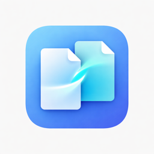
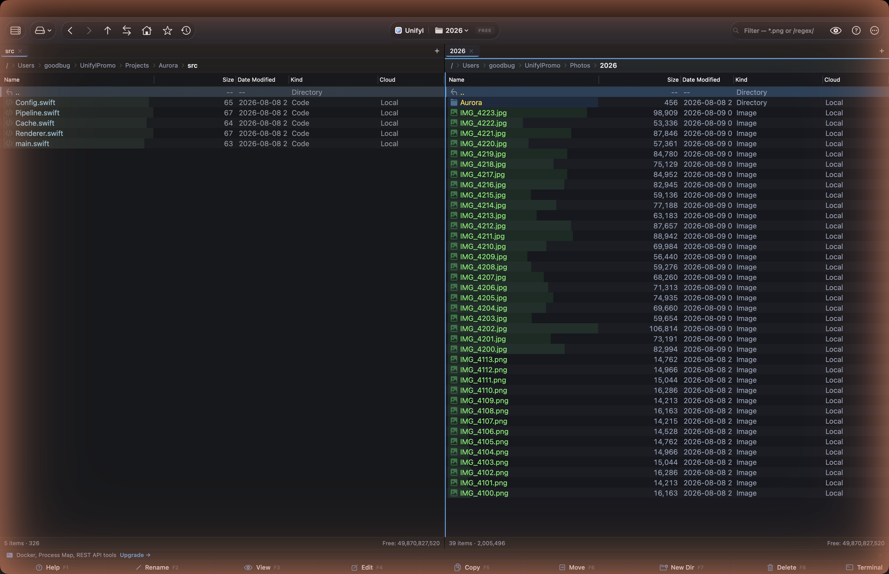

<h1 align="center">Unifyl</h1>

<strong>Il gestore file a doppio pannello con IA per macOS.</strong> La profondità di Total Commander, la rifinitura di ForkLift, intelligenza integrata.

<a href="https://unifyl.app/it/">Sito</a> &middot; <a href="https://github.com/goodbug89/Unifyl.app/wiki">Documentazione</a> &middot; <a href="https://github.com/goodbug89/Unifyl.app/releases/latest">Scarica</a>

Disponibile anche sul <a href="https://apps.apple.com/app/unifyl/id6773977314?mt=12">Mac App Store</a> (edizione sandbox — vedi le FAQ per le differenze di funzionalità).

<strong>Lingua:</strong> <a href="README.md">English</a> &middot; <a href="README.ja.md">日本語</a> &middot; <a href="README.zh-Hans.md">简体中文</a> &middot; <a href="README.de.md">Deutsch</a> &middot; <a href="README.es.md">Español</a> &middot; <a href="README.fr.md">Français</a> &middot; <strong>Italiano</strong>

---

## Panoramica

Unifyl è il gestore file a doppio pannello per macOS che combina strumenti professionali con intelligenza artificiale locale sul dispositivo. I tuoi file non lasciano mai il Mac.

- **Pilota automatico di Download** (novità della 2.0, Pro): osserva Download e le cartelle che aggiungi, propone una cartella per ogni nuovo file e non sposta nulla senza la tua approvazione; ⌘Z annulla. I nomi dei file vengono confrontati in qualsiasi lingua.
- **Doppio pannello** — Due pannelli affiancati o uno sopra l'altro, tab, spazi di lavoro, pannello Terminale e Terminale rapido (solo download diretto)
- **Alimentato da IA** — Ricerca semantica, rinomina con IA, tagging intelligente, rilevamento duplicati — tutto in locale sul Mac con i framework Natural Language e Vision di Apple
- **Remoto & cloud** — FTP/SFTP/WebDAV/SMB/S3/Google Drive/Dropbox/OneDrive/Docker/Kubernetes
- **Oltre 50 strumenti professionali** — Rinomina batch, confronto testo/binario/immagine, sincronizzazione directory, merge a 3 vie, editor EXIF batch
- **Archivi come cartelle virtuali** — ZIP/7z/TAR/GZ/BZ2/XZ/ZSTD/RAR (incluso rilevamento codifica per ZIP CJK legacy)
- **Tastiera prima di tutto** — Tavolozza comandi, navigazione in stile Vim, oltre 120 scorciatoie riassegnabili
- **15 lingue**
- **Rafforzamento CJK** (1.3.0): estrazione di archivi `.alz` (`unalz` integrato), anteprima inline di `.hwpx`, ricerca multilingue dei nomi file (Pinyin / Romaji / Hangul-Hanja)
- **Rafforzamento CJK esteso** (1.3.1): segnalibri automatici per cartelle di messaggistica/cloud (KakaoTalk · LINE · WeChat · iCloud Drive — 12 percorsi), riduzione larghezza intera/metà nella ricerca, conversione di codifica EUC-KR/Shift-JIS/GBK → UTF-8 (con annullamento), rilevamento euristico dei moduli governativi coreani

## Prezzo

| | **Free** | **Pro — $24.99** |
|---|---|---|
| Layout di pannello | Due pannelli, affiancati o uno sopra l'altro | Due pannelli, affiancati o uno sopra l'altro |
| Strumenti IA | — | Tutte le funzioni IA |
| Connessioni remote | FTP, SFTP | Tutti i protocolli + cloud |
| Archivi | ZIP | ZIP/7z/TAR/GZ/BZ2/XZ/ZSTD/RAR/**ALZ** |

> **Nota sulle edizioni.** La versione del Mac App Store gira in sandbox e non include il pannello Git, Docker/Kubernetes, i tunnel SSH, il terminale integrato, i visualizzatori di porte e processi, né la conversione multimediale basata su ffmpeg — macOS non lo consente lì. Tutto il resto è identico, e Pro costa lo stesso pagamento una tantum in entrambi i casi. Scegli il download diretto se ti serve uno di questi.

Acquisto unico, nessun abbonamento. Download gratuito sul Mac App Store (Pro tramite acquisto in-app, legato al tuo ID Apple con In famiglia) o download diretto (Pro tramite LemonSqueezy, utilizzabile su un massimo di 3 dispositivi). Prova Pro gratuita di 14 giorni al primo avvio.

Elenco completo di funzionalità, scorciatoie, guida alla compilazione e sviluppo di plug-in nel [README in inglese](README.md).

## Licenza

Proprietaria. Copyright 2024–2026 Unifyl. Tutti i diritti riservati.
