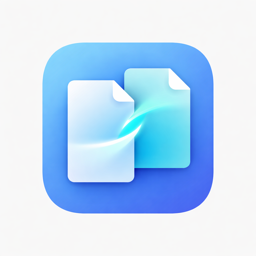
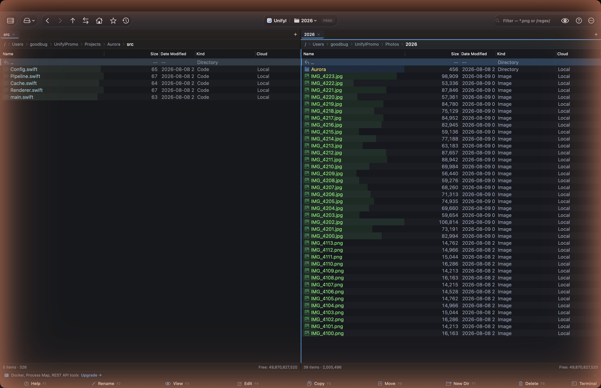

<h1 align="center">Unifyl</h1>

<strong>macOS için AI destekli çift bölmeli dosya yöneticisi.</strong> Total Commander'ın derinliği, ForkLift'in inceliği, dahili AI zekâsı.

<a href="https://unifyl.app/tr/">Web sitesi</a> &middot; <a href="https://github.com/goodbug89/Unifyl.app/wiki">Belgeler</a> &middot; <a href="https://github.com/goodbug89/Unifyl.app/releases/latest">İndir</a>

<a href="https://apps.apple.com/app/unifyl/id6773977314?mt=12">Mac App Store</a>'da da mevcuttur (sandbox sürümü — özellik farkları için SSS'ye bakın).

<strong>Dil:</strong> <a href="README.md">English</a> &middot; <a href="README.ja.md">日本語</a> &middot; <a href="README.zh-Hans.md">简体中文</a> &middot; <a href="README.de.md">Deutsch</a> &middot; <a href="README.es.md">Español</a> &middot; <a href="README.fr.md">Français</a> &middot; <strong>Türkçe</strong>

---

## Genel bakış

Unifyl, profesyonel araçları yerel cihaz üstü AI ile birleştiren macOS için çift bölmeli dosya yöneticisidir. Dosyalarınız asla Mac'inizden ayrılmaz.

- **İndirilenler Otopilotu** (2.0'da yeni, Pro) — İndirilenler'i ve eklediğiniz klasörleri izler, her yeni dosya için bir klasör önerir ve siz onaylamadan hiçbir şeyi taşımaz; ⌘Z geri alır. Dosya adları her dilde eşleştirilir.
- **Çift bölme** — Yan yana ya da üst üste iki panel, sekmeler, çalışma alanları, Terminal Paneli ve Hızlı Terminal (yalnızca doğrudan indirme sürümünde)
- **AI destekli** — Anlamsal arama, AI ile yeniden adlandırma, akıllı etiketleme, yinelenenleri tespit — tümü Apple'ın Natural Language ve Vision çerçeveleriyle Mac üzerinde yerel
- **Uzaktan & bulut** — FTP/SFTP/WebDAV/SMB/S3/Google Drive/Dropbox/OneDrive/Docker/Kubernetes
- **Profesyonel araçlar** — Toplu yeniden adlandırma, metin/ikili/resim karşılaştırma, dizin eşitleme, 3 yönlü birleştirme, EXIF toplu düzenleme
- **Arşivler sanal klasör olarak** — ZIP/7z/TAR/GZ/BZ2/XZ/ZSTD/RAR (eski CJK ZIP'lerinin otomatik kodlama algılaması dahil)
- **Klavye önce** — Komut paleti, Total Commander uyumlu tuşlar, yeniden atanabilir 120'den fazla kısayol
- **15 dil**
- **CJK güçlendirmesi** (1.3.0): `.alz` arşiv çıkarma (paketli `unalz`), `.hwpx` satır içi önizleme, çok dilli dosya adı arama (Pinyin / Romaji / Hangul-Hanja)
- **CJK güçlendirmesi genişletildi** (1.3.1): mesajlaşma/bulut klasörleri için otomatik yer imleri (KakaoTalk · LINE · WeChat · iCloud Drive — 12 yol), aramada tam/yarım genişlik katlaması, EUC-KR/Shift-JIS/GBK → UTF-8 kodlama dönüştürme (geri alma destekli), Kore hükümet formlarının sezgisel olarak algılanması

## Fiyat

| | **Free** | **Pro — $24.99** |
|---|---|---|
| Bölme düzenleri | İki panel, yan yana ya da üst üste | İki panel, yan yana ya da üst üste |
| AI araçları | — | Tüm AI fonksiyonları |
| Uzaktan bağlantılar | FTP, SFTP | Tüm protokoller + bulut |
| Arşivler | ZIP | ZIP/7z/TAR/GZ/BZ2/XZ/ZSTD/RAR/**ALZ** |

> **Sürüm notu.** Mac App Store sürümü kum havuzunda çalışır ve Git panelini, Docker/Kubernetes'i, SSH tünellerini, satır içi terminali, bağlantı noktası ve süreç görüntüleyicilerini ya da ffmpeg tabanlı medya dönüştürmeyi içermez — macOS orada buna izin vermiyor. Geri kalan her şey aynıdır ve Pro her iki kanalda da aynı tek seferlik ücrettir. Bunlardan birine ihtiyacınız varsa doğrudan indirmeyi seçin.

Tek seferlik satın alma, abonelik yok. Mac App Store'dan ücretsiz indirilir (Pro, Uygulama İçi Satın Alma ile; Apple Kimliğinize bağlı, Aile Paylaşımı destekli) veya doğrudan indirilir (Pro, LemonSqueezy ile; en fazla 3 cihazda kullanılabilir). İlk açılışta 14 günlük ücretsiz Pro denemesi.

Tüm özellik listesi, kısayollar, derleme kılavuzu ve eklenti geliştirme [İngilizce README](README.md)'de.

## Lisans

Tescilli. Telif hakkı 2024–2026 Unifyl. Tüm hakları saklıdır.
